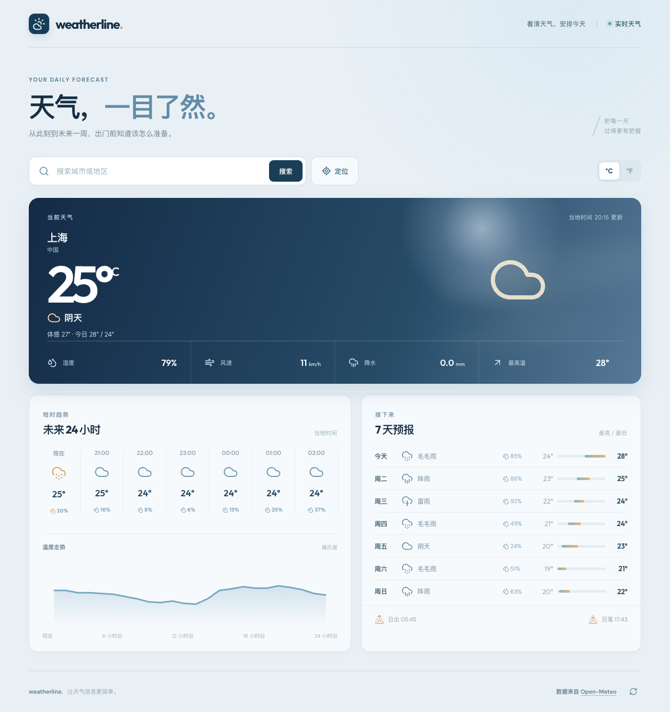

# Weatherline ☀️

一个使用 React 和 TypeScript 构建的天气应用。搜索城市后，可查看当前天气、未来 24 小时及未来 7 天的预报。项目对应前端面试作业，重点展示清晰的组件边界、API 整合、状态与错误处理。



## 本地启动

**环境要求：** Node.js 20.19+ 或 22.12+，npm 10+。无需注册天气服务，也无需配置 API Key。

```bash
git clone https://github.com/MMMystery/weatherline.git
cd weatherline
npm install
npm run dev
```

打开终端显示的地址，默认是 [http://localhost:5173](http://localhost:5173)。首次打开显示上海的天气；搜索其他地点后会记住上次选择的城市。

如需检查生产构建：

```bash
npm run build
npm run preview
```

其他命令：

| 命令 | 用途 |
| --- | --- |
| `npm run lint` | ESLint 静态检查 |
| `npm test` | 运行 API 异常处理、天气条件、单位换算与日期显示测试 |
| `npm run build` | TypeScript 检查并生成 `dist/` |

## 功能

- **地点搜索：** 支持中文或英文城市名，输入后展示候选地点；键盘可用上下方向键选择，Enter 确认，Escape 关闭。
- **当前位置：** 经用户授权后读取浏览器定位；定位失败会说明原因并允许改用搜索。定位功能在 `localhost` 或 HTTPS 环境下可用。
- **当前天气：** 温度、天气状况、体感温度、当天最高/最低温、湿度、风速与降水量。
- **天气预报：** 未来 24 小时逐小时天气及温度走势；未来 7 天的天气、最高/最低温、降水概率，以及当天日出/日落。
- **温度单位：** 可切换摄氏度与华氏度，切换时无需重新请求天气接口。
- **状态处理：** 加载反馈、无搜索结果提示、网络或数据错误提示、重试入口；切换地点时会取消过期请求，避免旧数据覆盖新结果。
- **响应式与可访问性：** 手机和桌面布局、语义化区域、可见焦点状态、减少动态效果的系统偏好支持。

## 实现方式

```text
src/
├── api/weather.ts          # Open-Meteo 请求与响应校验
├── components/
│   ├── LocationSearch.tsx  # 搜索、候选项与键盘交互
│   ├── CurrentConditions.tsx
│   ├── Forecast.tsx
│   └── WeatherIcon.tsx
├── utils/weather.ts        # WMO 天气代码、时间与温度显示
├── App.tsx                 # 页面状态、定位、重试与数据流
└── styles.css              # 视觉样式与响应式布局
```

天气与地点数据来自 [Open-Meteo Forecast API](https://open-meteo.com/en/docs) 和 [Geocoding API](https://open-meteo.com/en/docs/geocoding-api)。客户端直接请求公开 API；通过 `AbortController` 取消无效请求，并在渲染前检查关键响应字段。天气代码遵循 Open-Meteo 提供的 WMO 天气代码。

### 取舍

- 这是单页、只读应用，因此使用 Vite + React + TypeScript 和少量本地状态，没有引入路由或全局状态库。API、视图与格式化逻辑分开，便于继续扩展。
- 选用 Open-Meteo 的免 Key 接口，方便面试官克隆即运行。其免费公开接口适用于非商业演示；若用于商业服务，应确认其[授权与定价](https://open-meteo.com/en/pricing)。
- 为控制作业范围，没有加入账号、收藏列表或后台服务；只在 `localStorage` 保存最后选择的地点，不缓存天气结果，页面刷新会取最新数据。
- 定位地点以“当前位置”和坐标标注，因为所用 API 不提供反向地理编码；这样不会把附近城市误写成用户所在城市。

## 部署

运行 `npm run build` 后，`dist/` 可部署到任何静态网站托管服务。若启用定位，线上站点需要 HTTPS。应用没有服务器端密钥或环境变量。

## 数据来源

Weather data: [Open-Meteo](https://open-meteo.com/) · Location data: [GeoNames via Open-Meteo](https://open-meteo.com/en/docs/geocoding-api)
